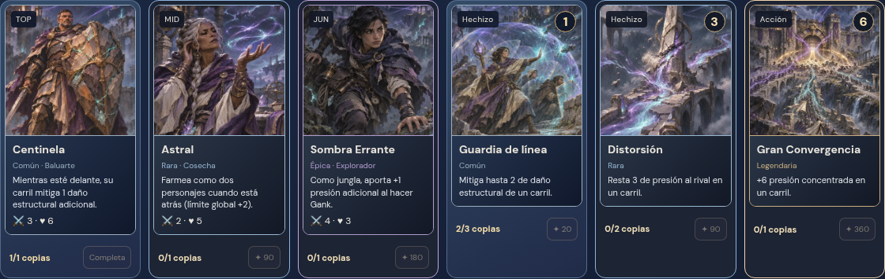

# Piloto de ilustraciones · tarea #92

Se generaron seis ilustraciones originales con `image_gen.imagegen` el 24 de noviembre de 2026 siguiendo `CARD_ART_BIBLE_v092.md`. La herramienta no expone nombre de modelo ni semilla; esos campos no se inventan. Los prompts exactos están en `assets/card-art/prompts.json`.

## Entrega y fidelidad

Las seis fuentes nativas son PNG RGB de **1086×1448**, proporción 3:4. Se conservan sin modificaciones en `assets/card-art/sources/`. Los maestros **1536×2048** son adaptaciones proporcionales Lanczos: **el aumento de resolución no aporta detalle nuevo**. Los WebP se calculan directamente desde la fuente nativa, a calidad 82, con perfil sRGB y tamaños exactos **768×1024, 384×512 y 192×256**. No hay marcos, nombres, costes ni estadísticas en el raster.

| ID | WebP 768 (KiB) | Foco x/y |
|---|---:|---|
| hero-centinela | 136.0 | .50/.25 |
| hero-astral | 147.5 | .50/.35 |
| hero-sombra | 125.3 | .50/.30 |
| great-convergence | 203.7 | .50/.40 |
| disrupt | 135.9 | .50/.40 |
| line-guard | 166.8 | .50/.45 |

El manifiesto JSON contiene rutas, dimensiones nativas y maestras, focos normalizados, alt en español y procedencia. Su módulo `.mjs` es generado por el mismo script para no depender de una petición JSON asíncrona al iniciar el juego. Ambos se validan para evitar divergencias.

## Integración

`src/card-game/card-renderer.mjs` comparte la cara de carta entre colección, selector de personajes, catálogo del constructor, sobres, mano y tablero. Resuelve identidad, texto, rareza y coste por ID del catálogo; recibe ataque y vida actuales del motor para el tablero. Los botones y sus eventos siguen perteneciendo a cada vista. `card-art.css` dibuja los marcos, placas de coste y etiquetas; el arte nunca intercepta clics.

Las imágenes usan `srcset`, `sizes`, dimensiones intrínsecas, `object-fit: cover` y foco por ID. El sobre muestra la obra 3:4 completa. Las otras 50 cartas mantienen un glifo CSS, sin generar ilustraciones adicionales. Si falla una imagen, el listener de errores elimina el elemento roto y deja visible el respaldo. Las opciones de movimiento reducido se respetan.

No se modifican catálogo, motor, reglas, balance, economía ni formatos de guardado.

## Verificación reproducible

```sh
python3 -m pip install Pillow==13.0.0
python3 scripts/process-card-art.py
python3 scripts/validate-card-art.py
node scripts/check-static.mjs
node --test tests/card-game*.test.mjs
node --test
node scripts/card-game-balance.mjs --seeds=20 --rounds=24
npm install --no-save --no-package-lock @playwright/test@1.56.1
# En una terminal aparte:
python3 -m http.server 3000 --bind 127.0.0.1
# Chromium instalado localmente, o bien omitir CHROMIUM_PATH tras instalar Playwright Chromium:
CHROMIUM_PATH=/usr/bin/chromium RIFT_TEST_URL=http://127.0.0.1:3000 npx playwright test e2e/card-art.spec.cjs e2e/card-game.spec.cjs e2e/ux-browser.spec.cjs --reporter=line
```

La validación decodifica los 30 archivos y comprueba formatos, RGB, perfil, dimensiones, presupuestos, IDs reales y concordancia de manifiestos. La prueba de navegador recorre 360/390/430/1440 px, exige ausencia de overflow de página y de texto recortado dentro de la carta, comprueba decodificación de los seis pilotos, selección, cambio de fila, cambio de ronda, guardado/recarga del mazo y uso sin imágenes. La regresión existente cubre sobres, colección, hotseat y objetivos.

Las capturas son **reales de Chromium**, con viewport móvil táctil de 390×844 (tamaño de iPhone) y escritorio de 1440 px. No representan una prueba en hardware iPhone ni en Safari/iOS. Los encuadres móviles usan desplazamiento normal de la página. La hoja de seis pilotos filtra los nodos reales de la colección únicamente para la captura de revisión; no es una pantalla adicional del producto.

## Capturas



| Vista | Móvil 390×844 | Escritorio 1440 px |
|---|---|---|
| Partida | [Captura](screenshots/card-art-v092/game-390.png) | [Captura completa](screenshots/card-art-v092/game-1440.png) |
| Colección | [Captura](screenshots/card-art-v092/collection-390.png) | [Captura](screenshots/card-art-v092/collection-1440.png) |
| Constructor | [Captura](screenshots/card-art-v092/builder-390.png) | [Captura](screenshots/card-art-v092/builder-1440.png) |

También se incluyen las tres vistas a 360 y 430 px. Revisar este piloto antes de ampliar el set.

## Inventario exacto

```text
assets/card-art/manifest.json
assets/card-art/manifest.mjs
assets/card-art/masters/disrupt.png
assets/card-art/masters/great-convergence.png
assets/card-art/masters/hero-astral.png
assets/card-art/masters/hero-centinela.png
assets/card-art/masters/hero-sombra.png
assets/card-art/masters/line-guard.png
assets/card-art/prompts.json
assets/card-art/sources/disrupt.png
assets/card-art/sources/great-convergence.png
assets/card-art/sources/hero-astral.png
assets/card-art/sources/hero-centinela.png
assets/card-art/sources/hero-sombra.png
assets/card-art/sources/line-guard.png
assets/card-art/webp/disrupt-192.webp
assets/card-art/webp/disrupt-384.webp
assets/card-art/webp/disrupt-768.webp
assets/card-art/webp/great-convergence-192.webp
assets/card-art/webp/great-convergence-384.webp
assets/card-art/webp/great-convergence-768.webp
assets/card-art/webp/hero-astral-192.webp
assets/card-art/webp/hero-astral-384.webp
assets/card-art/webp/hero-astral-768.webp
assets/card-art/webp/hero-centinela-192.webp
assets/card-art/webp/hero-centinela-384.webp
assets/card-art/webp/hero-centinela-768.webp
assets/card-art/webp/hero-sombra-192.webp
assets/card-art/webp/hero-sombra-384.webp
assets/card-art/webp/hero-sombra-768.webp
assets/card-art/webp/line-guard-192.webp
assets/card-art/webp/line-guard-384.webp
assets/card-art/webp/line-guard-768.webp
```
